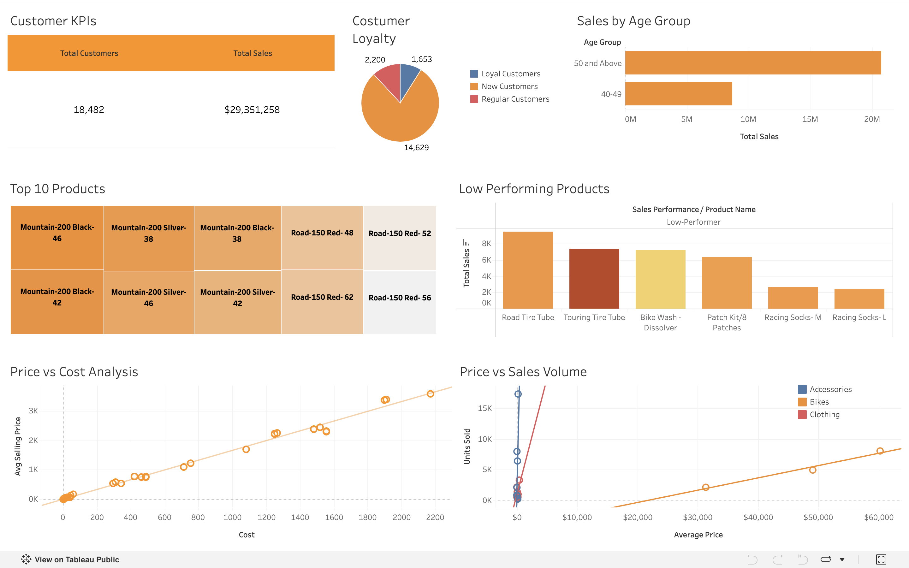

# SQL Data Analytics Portfolio Project

## Project Overview

In this portfolio project, I show how SQL can be used to analyze the performance of retail sales, customer behaviors, and product performance. Using SQL queries, I explored sales trends, evaluated product performance over time, segmented customers and products, and developed reusable customer and product reports.

Finally, I used the customer and products reports to create an interactive Tableau Public dashboard. It displays business KPIs and product trends with data visualization.

## Tools & Technologies

- **SQL Server / SSMS:** Data analysis, aggregation, segmentation, and reporting
- **Tableau Public:** Interactive dashboard development and data visualization
- **GitHub:** SQL code organization and project documentation

## Business Questions

- How do sales, customer counts, and quantities sold change over time?
- How does product performance compare with historical averages and previous-year sales?
- Which product categories contribute the most to overall sales?
- How can customers be segmented based on spending behavior and customer lifespan?
- How can products be classified by cost and sales performance?
- Which customer and product metrics can support business reporting?

## SQL Skills Demonstrated

- Common table expressions (CTEs)
- Joins and aggregate functions
- Window functions, including `LAG` and running totals
- Date-based analysis and aggregation
- Conditional logic using `CASE`
- Segmentation of customers and products
- Creating reusable SQL views
- Calculation of customer and product performance metrics

## Tableau Dashboard

The Tableau dashboard represents retail sales and customer analytics through KPIs of customers, loyalty segments of customers, sales according to age, product performance comparison, and price versus cost and sales volume visualization.

**View the interactive dashboard:** [https://public.tableau.com/app/profile/josiah.varghese/viz/CustomerandProductAnalysis_17927435793560/CustomerandProductReportDashboard]

### Dashboard Preview

## Project Structure

- `dashboard/` – Tableau dashboard screenshot and related files
- `scripts/` – SQL scripts organized by analytical task
- `README.md` – Project documentation and overview

## Customer and Product Reporting

This project contains reusable SQL views for the customer and product reports.

The customer report includes the total orders, total sales, quantity of purchase, customer recency, order value, and average monthly spending.

The product report includes total sales, order volume, customer count, average selling price, classification of product performance, and average monthly revenue.

## Project Acknowledgment

This SQL portion of this project was created with the help of the Data With Baraa SQL Data Analyst Portfolio Project tutorial. The project gave me the chance to practice SQL analytics and reporting. I then created the interactive Tableau Public dashboard to visualize business metrics on my own.

## Key Takeaway

All in all, this project shows how the SQL can be crucial in transforming raw sales data into valuable business analysis and how Tableau can present analytical results in a visual, accessible format.
